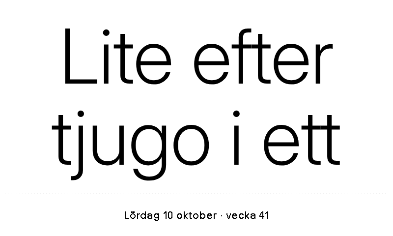

# Ungefär-klocka

Plugin för [TRMNL](https://trmnl.com) (e-pappersskärm). Svensk "ungefär-tid" för e-papper: *Typ kvart över fem*, *Runt fem i halv åtta*, *Nyss fem i fyra*, plus datum och veckonummer.



Alla fyra layouter (full, half_horizontal, half_vertical, quadrant) finns, så den fungerar i mashups.
Se [`preview/overview.png`](preview/overview.png).
Testad i liggande och stående format samt på TRMNL X: [stående](preview/full.portrait.png), [TRMNL X](preview/full.x.png).

## Inställningar

- **Framförhållning** – lämna tomt för automatiskt läge: halva pluginens + halva enhetens uppdateringsintervall (15 min när båda är 15 min). Ange ett tal för att styra själv.

## Installera

**Import:** zippa innehållet i `src/` (platt, inga mappar) och välj TRMNL → Plugins → Private Plugin → **Import new**.

```sh
cd src && zip ../klocka.zip * && cd ..
```

**[trmnlp](https://github.com/usetrmnl/trmnlp):**

```sh
trmnlp login    # en gång
trmnlp push     # laddar upp src/; lägg sedan till id: i src/settings.yml
trmnlp serve    # förhandsvisning på http://localhost:4567 med värdena i .trmnlp.yml
```

## Om

Tiden räknas ut vid rendering. Polling-URL:en (timeapi.io) är bara en "tick" så att TRMNL ritar om skärmen. Prefixen finns i `src/shared.liquid` och är lätta att lägga till.

## Licens

[MIT](LICENSE)
